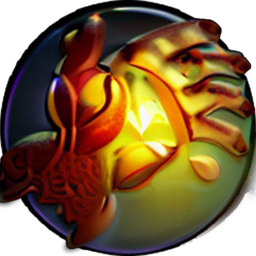
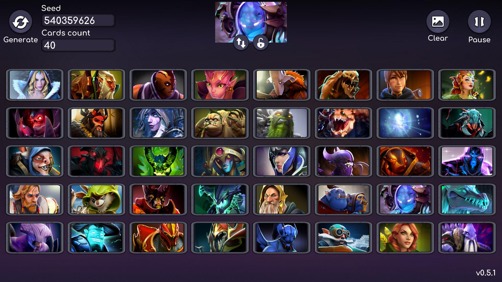
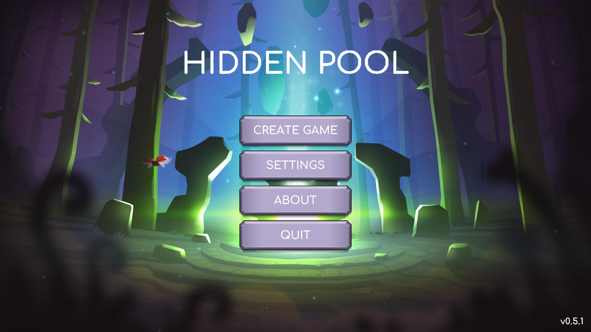
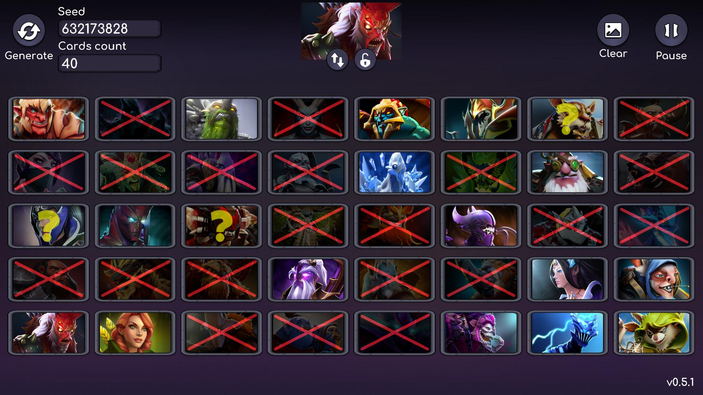
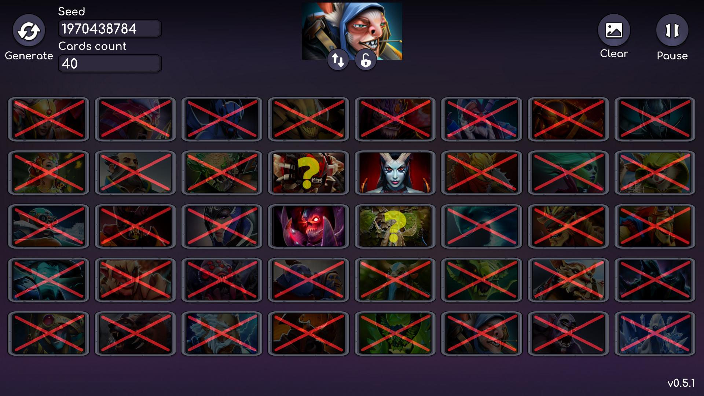
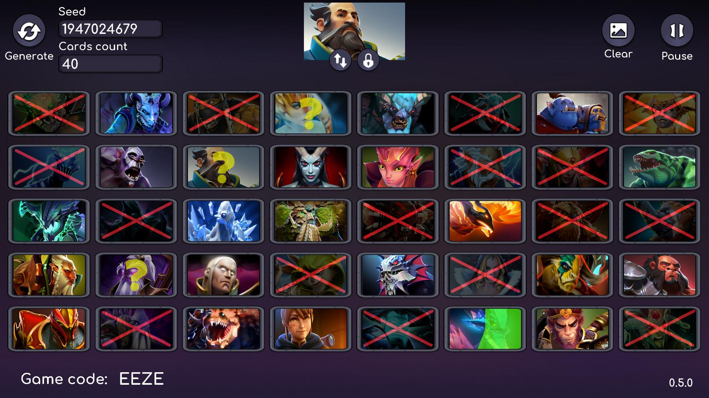

<div align="center">



# Hidden Pool

**A "Guess Who?" party game built around Dota 2 heroes.**
Share a seed with a friend, get the same board, hide your hero — and find theirs first.

[](https://unity.com/releases/editor/whats-new/2022.3.62)
[](#tech-stack)
[](ProjectSettings/ProjectSettings.asset)
[](#platforms)
[](Assets/Resources/Localization)



</div>

---

## About

**Hidden Pool** is a two-player deduction game in the spirit of the classic *Guess Who?* board game, using the hero pool of Dota 2 (126 portraits, up to Kez, Muerta and Ringmaster).

There is no server and no matchmaking: both players generate an **identical board from a shared seed** and play over voice chat (Discord, a stream, a call). Each player secretly holds one hero, and you take turns asking yes/no questions — *"Is your hero melee?"*, *"Does it have a beard?"*, *"Is it an Intelligence hero?"* — crossing out cards until someone names the opponent's hero.

## How to play

1. Both players press **Create Game**.
2. One player shares the **seed** and **cards count** shown at the top of the board; the other enters the same values and presses **Generate**. Both boards are now identical.
3. Your secret hero is shown in the top slot. Reroll it with ↻, lock it with 🔒, or pick one yourself with a right click.
4. Take turns asking yes/no questions and mark the cards that no longer fit.
5. The first player to correctly name the opponent's hero wins. Press **Clear** for a rematch on the same board or **Generate** for a new one.

### Controls

| Input | Action |
| --- | --- |
| **Left click** | Cycle the card mark: ❌ crossed out → ❓ maybe → none |
| **Middle click** | Clear the card mark |
| **Right click** | Make this card your secret hero (unless locked) |
| **Esc** | Pause |

## Screenshots

<div align="center">
<table>
  <tr>
    <td></td>
    <td></td>
  </tr>
  <tr>
    <td align="center"><sub>Main menu</sub></td>
    <td align="center"><sub>Narrowing it down</sub></td>
  </tr>
  <tr>
    <td></td>
    <td></td>
  </tr>
  <tr>
    <td align="center"><sub>Endgame — a few suspects left</sub></td>
    <td align="center"><sub>Crossed out and "maybe" marks</sub></td>
  </tr>
</table>
</div>

## Features

- 🎲 **Seed-based boards** — the same seed and card count always produce the same set of heroes, so no networking is needed.
- 🦸 **126 Dota 2 heroes** with configurable board size (up to the full pool).
- ✍️ **Three-state marking** — crossed out, "maybe", or clear — with snappy DOTween feedback.
- 🔒 **Secret hero lock** so a stray right click never swaps your pick.
- 🌐 **English and Russian** localization.
- 🔊 Sound and music volume, fullscreen/windowed toggle, saved between sessions.
- 📱 Safe-area aware UI for phones with notches.

## Tech stack

| Area | Used |
| --- | --- |
| Engine | Unity **2022.3.62f3** (LTS), uGUI + TextMeshPro |
| Reactive / async | [UniRx](https://github.com/neuecc/UniRx), [UniTask](https://github.com/Cysharp/UniTask) |
| Animation | [DOTween](http://dotween.demigiant.com/) |
| Editor tooling | Asset Usage Detector, Build Report Tool |
| Localization | Simple Localization (CSV, EN/RU) |
| Analytics | GameAnalytics SDK |
| UI art | GUI PRO Kit – Fantasy RPG |

## Project structure

```
Assets/
├── Data/                 # ScriptableObject instances: AppData, MatchData, PacksData, UserData
├── Scenes/Main.unity     # The only scene
├── Scripts/
│   ├── Components/       # CardBase — a single card and its marks
│   ├── Data/             # ScriptableObject definitions (MatchData holds a reactive game state)
│   ├── Systems/          # CardsGenerateSystem, SaveData, Settings, SoundDesigner, hotkeys
│   ├── UI/Menues/        # InterfaceManager + BaseMenu-derived screens
│   └── Localization/     # Localization bootstrap
├── Resources/Localization/  # CSV string tables
├── Sprites/HeroesPortraits/  # Hero portraits used for cards
└── WebGLTemplates/Responsive/
```

The game flow is driven by a `ReactiveProperty<MatchData.State>` (`MainMenu → InitializeGame → Game → EndGame`); systems and menus subscribe to it instead of calling each other directly. Screens derive from `BaseMenu` and are switched through `InterfaceManager`.

## Getting started

1. Install **Unity 2022.3.62f3** via Unity Hub (add Android / WebGL modules if you need those builds).
2. Clone the repository:
   ```bash
   git clone https://github.com/BasteArima/HiddenPool.git
   ```
3. Open the folder in Unity Hub and load `Assets/Scenes/Main.unity`.
4. Press **Play**.

> **Android release builds** are signed with a keystore that is not part of the repository. Put your own keystore at `Keys/HiddenPool.keystore` (the `Keys/` folder is git-ignored) or pick another one in *Player Settings → Publishing Settings*.

## Platforms

| Platform | Notes |
| --- | --- |
| Windows | Standalone build, fullscreen/windowed toggle |
| Android | Package `com.KatharsisGames.HiddenPools` |
| WebGL | Uses the bundled responsive WebGL template |

## Credits

- **Author:** Mr.Robot (Midaser) · KatharsisGames
- **Music:** [LIVING PUFF](https://youtu.be/3MqYSgN9lMU)
- [Privacy Policy](https://katharsisgames.baste.ru/privacy_policy/privacy_policy_hidden_pool.html)

> Hidden Pool is a fan-made project and is not affiliated with or endorsed by Valve Corporation. Dota 2 and all hero names and portraits are trademarks and property of Valve Corporation.
